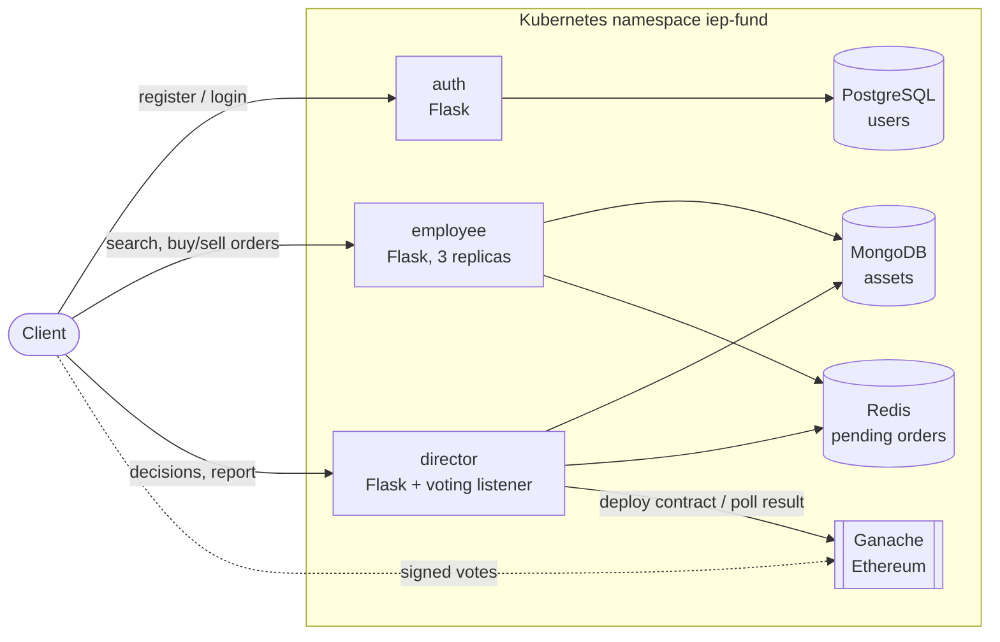

# Investment Fund Management System

[](https://github.com/mmileticc/IEP_project/actions/workflows/ci.yml)

A microservice backend for running an investment fund. Employees propose buying and selling
assets, the fund director approves or rejects each proposal, and approvals can optionally be
decided by a **majority vote on an Ethereum smart contract**. The whole system runs on
Kubernetes.

Built as a university project for the *Infrastructure for Electronic Business* course
(School of Electrical Engineering, University of Belgrade), where it passed the official
grading suite with 179/179 points.

## Architecture



| Service | Responsibility | Storage |
|---|---|---|
| `auth` | Registration, login, account deletion, JWT issuing | PostgreSQL via SQLAlchemy ORM |
| `employee` | Asset search, creating BUY/SELL orders | MongoDB (assets), Redis (pending orders) |
| `director` | Reviewing orders, approving them directly or through an on-chain vote, category report | MongoDB, Redis, Ganache via web3.py |

All three services share the `services/common` package: JWT role checks, request validation,
JSON error handling, and the Redis order store.

### Order lifecycle

1. An employee creates a BUY or SELL order. It is stored in Redis as *pending*.
2. The director lists pending orders and decides:
   - **Immediate mode**: `{"uuid", "approved"}` applies or discards the order right away.
   - **Blockchain mode**: `{"uuid", "voters"}` deploys an `OrderVoting` contract
     ([Voting.sol](services/director/app/contracts/Voting.sol)) that only the listed (odd number of)
     addresses may vote on. The response contains unsigned approve and reject transactions, which
     each voter signs and sends.
3. A background listener in the director service polls every active contract. Once one side
   holds a strict majority, the order is removed from Redis and, if approved, recorded in MongoDB.
4. `GET /report` aggregates money spent and earned per category with a MongoDB aggregation
   pipeline.

## Tech stack

Python 3.11 · Flask · SQLAlchemy · PyMongo · redis-py · flask-jwt-extended · web3.py ·
Solidity 0.8 · PostgreSQL 16 · MongoDB 7 · Redis 7 · Ganache · Docker · Kubernetes ·
pytest · GitHub Actions

## Quick start

### Kubernetes (Docker Desktop)

Prerequisite: Docker Desktop with Kubernetes enabled (*Settings → Kubernetes → Enable Kubernetes*).

```bash
make up          # or: ./scripts/k8s-up.sh       (Windows: .\scripts\k8s-up.ps1)
```

The script builds the three images, applies [`k8s/`](k8s), waits until every pod is ready, and
prints the endpoints:

| Service | URL |
|---|---|
| auth | http://127.0.0.1:5000 |
| employee | http://127.0.0.1:5001 |
| director | http://127.0.0.1:5002 |
| ganache | http://127.0.0.1:8545 |

A director account is seeded on startup: `onlymoney@gmail.com` / `evenmoremoney`.

Run `make down` (or `.\scripts\k8s-down.ps1`) to delete the namespace with all its data.
Run `make up-fast` (`-SkipBuild`) to redeploy without rebuilding the images.

Blockchain voting is enabled by default. To switch to immediate decisions, set
`BLOCKCHAIN_ENABLED: "false"` in [`k8s/01-configmap.yaml`](k8s/01-configmap.yaml), then run:

```bash
kubectl apply -f k8s/01-configmap.yaml
kubectl rollout restart deployment/director -n iep-fund
```

### Docker Compose

A lighter setup with a single employee replica:

```bash
cp .env.example .env
docker compose up --build
```

## API

Every employee and director endpoint requires `Authorization: Bearer <accessToken>` with the
matching role. A missing, invalid or expired token, and a token with the wrong role, all get the
same response: `401 {"msg": "Missing Authorization Header"}`. Validation errors return
`400 {"message": "..."}`.

| Service | Method & path | Role | Body | Success |
|---|---|---|---|---|
| auth | `POST /register` | — | `forename, surname, email, password` | `200` |
| auth | `POST /login` | — | `email, password` | `200 {"accessToken"}` |
| auth | `POST /delete` | any | — | `200` (deletes the caller's account) |
| employee | `POST /search` | employee | optional `name, category, buying_date, selling_date, info_filters[]` | `200 {"assets": [...]}` |
| employee | `POST /create_buy_order` | employee | `name, categories[], buying_price, info{}` | `200` |
| employee | `POST /create_sell_order` | employee | `id, selling_price` | `200` |
| director | `GET /pending_orders` | director | — | `200 {"orders": [...]}` |
| director | `POST /decision` | director | `uuid` + `approved` (immediate) or `voters[]` (blockchain) | `200`, or the vote transactions in blockchain mode |
| director | `GET /report` | director | — | `200 {"statistics": [{category, spent, earned}]}` |
| all | `GET /health` | — | — | `200 {"status": "ok"}` |

`info_filters` items look like `{"field": "geo.country", "operator": "eq", "value": "RS"}`.
The supported operators are `eq, ne, gt, gte, lt, lte, in, nin`.

<details>
<summary>Example session</summary>

```bash
TOKEN=$(curl -s -X POST localhost:5000/login -H 'Content-Type: application/json' \
  -d '{"email":"john@gmail.com","password":"Aa123456"}' | jq -r .accessToken)

curl -X POST localhost:5001/create_buy_order -H "Authorization: Bearer $TOKEN" \
  -H 'Content-Type: application/json' \
  -d '{"name":"AssetAlpha","categories":["Technology"],"buying_price":1000,"info":{"region":"EU"}}'
```
</details>

## Tests

The unit tests use in-memory fakes (SQLite, mongomock, fakeredis), so no running database is needed.

```bash
python -m venv .venv && source .venv/bin/activate   # Windows: .venv\Scripts\Activate.ps1
pip install -r requirements-dev.txt
make test        # runs pytest once per service
make lint
```

Without `make`, run `python -m pytest services/<common|auth|employee|director>` for each service.
CI runs the linter, the tests and the image builds on every push.

## Design notes

- **Pre-compiled contract.** The director image never runs the Solidity compiler.
  [`Voting.compiled.json`](services/director/app/contracts/Voting.compiled.json) holds the ABI and
  bytecode, so builds and deployments work offline. After editing `Voting.sol`, regenerate it with
  `make compile-contract` (it uses the `ethereum/solc` Docker image).
- **Exactly-once order resolution.** Orders are claimed with an atomic Redis `SREM` before they
  are applied, so concurrent decisions or listener retries cannot apply an order twice. A second
  vote on the same order is rejected.
- **Unique image tags.** Docker Desktop's containerd can keep running a stale `:latest` image
  after a rebuild. `k8s-up` tags each build with a timestamp and points the deployments at that
  tag.
- **Safe schema bootstrap.** `auth` creates its schema and seeds the director on startup. It
  tolerates several workers racing to do the same, and retries until Postgres is reachable.
- **Single director replica.** The vote listener runs inside the director process, so the
  director runs as one replica (with threads), while the stateless employee service runs three.
- **Demo secrets.** [`k8s/02-secret.yaml`](k8s/02-secret.yaml) and `.env.example` contain demo
  credentials. MongoDB and Redis run without authentication and are reachable only inside the
  cluster. Replace both before any real deployment.

More operational commands (inspecting the databases, manual rebuilds) are in
[docs/operations.md](docs/operations.md).

## Repository layout

```
services/
├── common/      shared package: JWT roles, validation, errors, Redis orders, Mongo helpers
├── auth/        Flask + SQLAlchemy (PostgreSQL)
├── employee/    Flask + PyMongo + Redis
└── director/    Flask + PyMongo + Redis + web3.py, Voting.sol
k8s/             Namespace, ConfigMaps, Secret, StatefulSets, Deployments, Services
scripts/         k8s-up / k8s-down / compile-contract (bash and PowerShell)
```

## License

[MIT](LICENSE)
